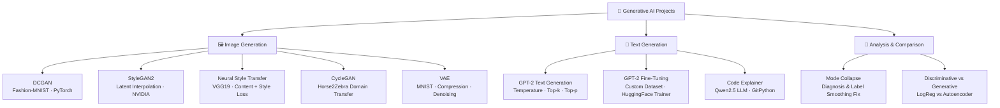

<p align="center">
  
</p>

<p align="center">
  
  
  
  
  
  
</p>

---

## 📋 Executive Summary

A comprehensive portfolio of **Generative AI** projects spanning the full spectrum of modern generative models — from **DCGANs** and **StyleGAN2** to **Variational Autoencoders (VAEs)**, **Neural Style Transfer**, **CycleGAN**, and **Large Language Model fine-tuning**. Each project is implemented as an independent Jupyter Notebook with hands-on experiments, visualizations, and analysis.

This collection demonstrates practical expertise in training generative adversarial networks, exploring latent spaces, diagnosing and fixing mode collapse, performing image-to-image translation, fine-tuning GPT-2, and building AI-powered code explanation tools using Qwen LLMs.

---

## 📑 Table of Contents

- [Key Features & Capabilities](#-key-features--capabilities)
- [Project Catalog](#-project-catalog)
- [System Architecture](#-system-architecture)
- [Tech Stack Breakdown](#-tech-stack-breakdown)
- [Quickstart & Setup](#-quickstart--setup)
- [Project Directory Layout](#-project-directory-layout)
- [Author & Contributions](#-author--contributions)

---

## ✨ Key Features & Capabilities

- **DCGAN on Fashion-MNIST** — Full training pipeline with Generator & Discriminator networks, loss curves, and epoch-wise generated image progression using PyTorch
- **StyleGAN2 Latent Space Exploration** — Latent vector interpolation, dimension manipulation, and GIF generation using NVIDIA's pretrained StyleGAN2-ADA
- **Neural Style Transfer vs CycleGAN** — Side-by-side comparison of VGG19-based style transfer and CycleGAN (horse2zebra) image translation with analysis
- **Mode Collapse Diagnosis & Fix** — Deliberate GAN destabilization followed by recovery using label smoothing and learning rate tuning on MNIST
- **Discriminative vs Generative Models** — Logistic Regression (discriminative) vs Autoencoder (generative) comparison on MNIST digit classification
- **GPT-2 Text Generation Experiments** — Temperature, top-k, top-p, and repetition penalty analysis with comparative output tables
- **GPT-2 Fine-Tuning on Custom Text** — End-to-end fine-tuning pipeline using HuggingFace Trainer with custom conversational dataset
- **Variational Autoencoder (VAE)** — MNIST image compression, reconstruction, denoising, and latent dimension impact analysis
- **GitHub Repository Code Explainer** — LLM-powered tool using Qwen2.5-0.5B-Instruct to clone repos and generate natural-language code explanations

---

## 📖 Project Catalog

| Assignment | Notebook | Topic | Key Libraries |
|-----------|----------|-------|---------------|
| **Assignment 4** | `ASSIGNMENT_4.ipynb` | DCGAN Training on Fashion-MNIST | PyTorch, Torchvision |
| **Assignment 5** | `ASSIGNMENT 5 GEN AI .ipynb` | StyleGAN2 Latent Space Exploration | PyTorch, NVIDIA StyleGAN2-ADA |
| **Assignment 6** | `ASSIGNMENT_6.ipynb` | Neural Style Transfer vs CycleGAN | PyTorch, VGG19, CycleGAN |
| **Assignment 7** | `Assignment_7.ipynb` | Mode Collapse — Diagnosis & Fix | TensorFlow, Keras |
| **Assignment 10** | `Assignment_10.ipynb` | VAE — Compression, Reconstruction, Denoising | TensorFlow, Keras |
| **Assignment 11** | `Assignment_11_.ipynb` | Fine-Tuning GPT-2 on Custom Text | HuggingFace Transformers |
| **Mini Assignment** | `Local_GitHub_Repository_Code_Explainer.ipynb` | LLM-Powered Code Explainer | Qwen2.5, GitPython |
| **Experiment** | `Untitled11.ipynb` | Discriminative vs Generative Models (MNIST) | TensorFlow, Scikit-learn |
| **Experiment** | `Untitled13.ipynb` | GPT-2 Text Generation — Decoding Strategies | HuggingFace Transformers |

---

## 🏗️ System Architecture



---

## 🛠️ Tech Stack Breakdown

| Category | Technology | Purpose |
|----------|-----------|---------|
| **Language** | Python 3.8+ | Core programming language |
| **Deep Learning** | PyTorch | DCGAN, StyleGAN2, Neural Style Transfer, CycleGAN |
| **Deep Learning** | TensorFlow / Keras | GAN mode collapse experiments, VAE, Autoencoders |
| **NLP / LLMs** | HuggingFace Transformers | GPT-2 text generation & fine-tuning, Qwen2.5 |
| **Training** | HuggingFace Accelerate | Distributed training & mixed precision |
| **Data** | HuggingFace Datasets | Dataset loading & tokenization |
| **Computer Vision** | Torchvision | Data transforms, VGG19 pretrained model |
| **Git Automation** | GitPython | Repository cloning for code explainer |
| **Visualization** | Matplotlib | Training curves, generated images, comparisons |
| **ML Utilities** | Scikit-learn | Logistic Regression, preprocessing |
| **Notebooks** | Jupyter / Google Colab | Interactive development with GPU support |

---

## 🚀 Quickstart & Setup

### Prerequisites

- Python 3.8 or higher
- GPU recommended (Google Colab with GPU runtime is ideal)
- ~5 GB disk space for model weights

### Installation

```bash
# Clone the repository
git clone https://github.com/Chaturyathukivakam/GenAI.git
cd GenAI

# Create and activate virtual environment
python -m venv venv
source venv/bin/activate        # macOS / Linux
# venv\Scripts\activate          # Windows

# Install core dependencies
pip install torch torchvision tensorflow numpy matplotlib
pip install transformers datasets accelerate sentencepiece
pip install scikit-learn gitpython pillow imageio
```

### Run the Notebooks

```bash
# Launch Jupyter
jupyter notebook

# Or open any .ipynb file directly in Google Colab
```

> 💡 **Tip:** Assignments 4, 5, and 11 require GPU acceleration. Use Google Colab with a T4/A100 runtime for best results.

---

## 📂 Project Directory Layout

```
GenAI/
├── ASSIGNMENT_4.ipynb                          # DCGAN — Fashion-MNIST
├── ASSIGNMENT 5 GEN AI .ipynb                  # StyleGAN2 Latent Space Exploration
├── ASSIGNMENT_6.ipynb                          # Neural Style Transfer vs CycleGAN
├── Assignment_7.ipynb                          # Mode Collapse — Diagnosis & Fix
├── Assignment_10.ipynb                         # VAE — Compression & Denoising
├── Assignment_11_.ipynb                        # GPT-2 Fine-Tuning on Custom Text
├── Local_GitHub_Repository_Code_Explainer.ipynb # LLM-Powered Code Explainer (Qwen2.5)
├── Untitled11.ipynb                            # Discriminative vs Generative Models
├── Untitled13.ipynb                            # GPT-2 Text Generation Strategies
└── README.md                                   # Project documentation
```

---

## 👤 Author & Contributions

**Chaturya Thukivakam**

[](https://github.com/Chaturyathukivakam)

Contributions, issues, and feature requests are welcome! Feel free to open a pull request.

---

<p align="center">
  
</p>
